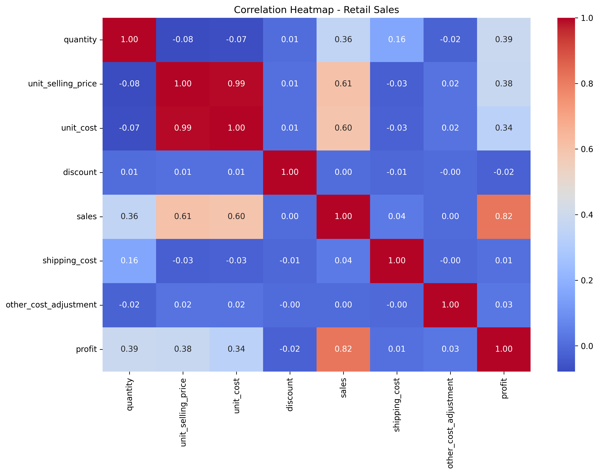
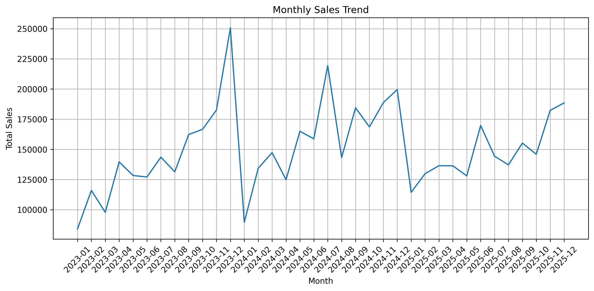
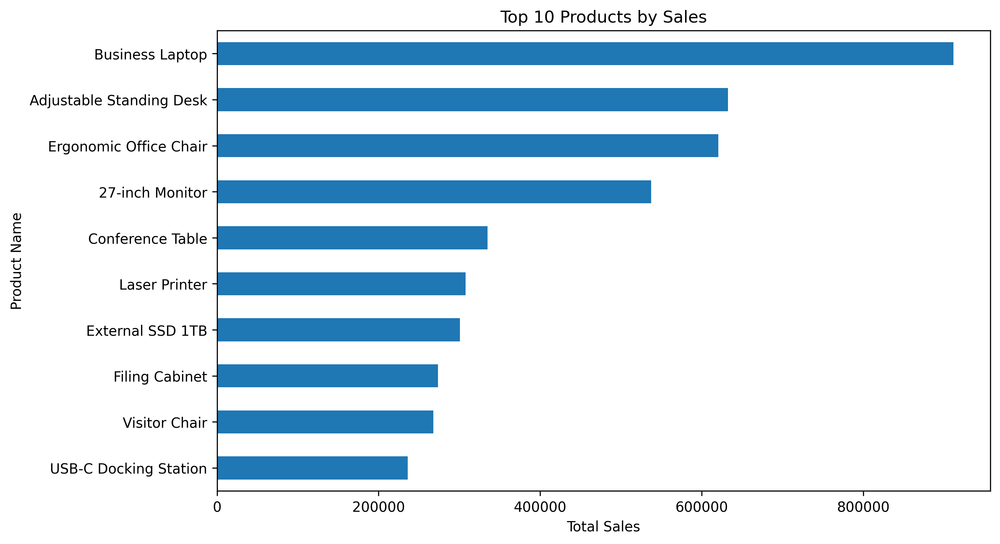

# Retail Sales Data Cleaning & Exploratory Data Analysis (EDA)

Cleaning and exploring a raw retail sales dataset with Python to uncover what drives sales and profit.

## Project Overview
The raw dataset contained common data-quality problems such as extra whitespace, wrong data types, missing values and duplicate records. This project cleans the data and then analyzes sales and profit patterns across categories, customer segments, products and time.

## Dataset
File: `data/retail_sales_raw.csv`
Key columns: order date, ship date, customer name, city, segment, category, sub-category, product name, quantity, unit cost, unit selling price, discount, sales, profit, shipping cost, payment method.

## Data Cleaning Steps
- Removed leading/trailing whitespace from text columns
- Removed the `%` symbol from the discount column and converted it to numeric
- Standardized column names (lowercase, underscores)
- Converted sales and discount to numeric and order/ship dates to datetime
- Filled missing text values with "Unknown"
- Filled missing quantity and unit cost with the median, discount with 0
- Recalculated missing sales (quantity × unit selling price) and profit (sales − cost − shipping + adjustments)
- Filled missing dates with the most frequent date
- Removed duplicate records

## Analysis & Visualizations
- Correlation heatmap of numeric features
- Total sales by category
- Total sales by customer segment
- Total profit by category
- Monthly sales trend
- Top 10 products by sales
- Sales distribution (histogram)
- Profit distribution and outliers (box plot)
- Sales vs profit (scatter plot)

## Key Insights
- **Technology is the top category**, with roughly 2.7M in total sales, followed by Furniture at about 2.4M. Office Supplies is far behind at around 0.3M.
- **Business Laptop is the best-selling product**, with over 900K in sales. The Adjustable Standing Desk and Ergonomic Office Chair follow at about 630K and 620K, so sales are driven by a few high-priced Technology and Furniture items.
- **Sales peaked in December 2023 at about 250K**, then dropped sharply to about 90K in January 2024. A smaller year-end rise and January drop repeat in 2024-2025, which suggests seasonality.
- **Sales ended 2025 strong**, recovering from a mid-year dip to about 188K in December 2025.
- **Sales is the strongest driver of profit** (correlation 0.82), followed by quantity (0.39) and unit selling price (0.38).
- **Discount and shipping cost show almost no linear relationship with profit** (around 0), so profit is driven mainly by what is sold and in what volume.
- **Unit cost and unit selling price are almost perfectly correlated** (0.99), which shows prices are set as a consistent markup over cost.

## Sample Visuals

### Correlation Heatmap

### Total Sales by Category
.png)

### Monthly Sales Trend

### Top 10 Products by Sales

## Tools Used
Python · Pandas · NumPy · Matplotlib · Seaborn · Google Colab / Jupyter Notebook

## How to Run
1. Clone this repository
2. Install dependencies: `pip install pandas numpy matplotlib seaborn`
3. Open `notebooks/retail_sales_eda.ipynb` in Jupyter or Google Colab
4. Run all cells

## Author
**Muhammed Nihad TP**

LinkedIn:www.linkedin.com/in/muhammed-nihad-tpy
